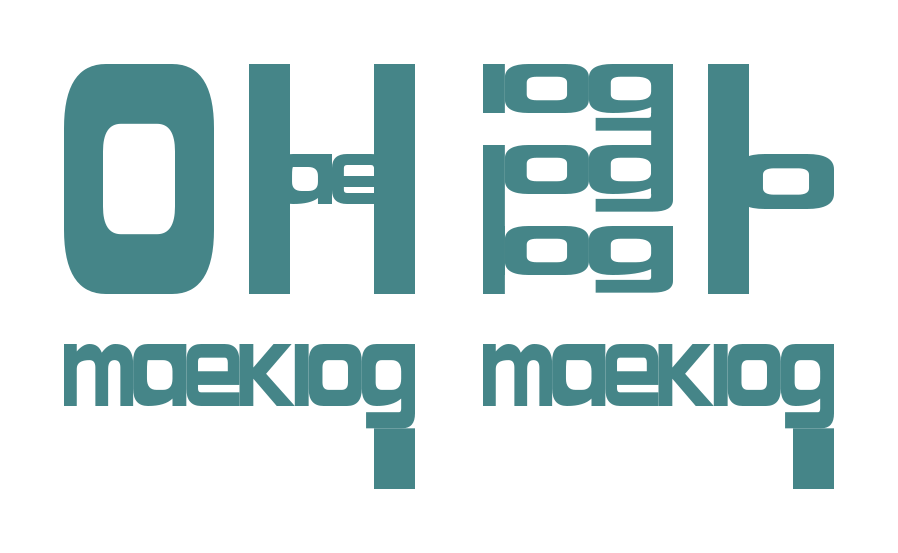

<p align="center">
  <picture>
    <source media="(prefers-color-scheme: dark)" srcset="docs/assets/brand/maeklog-logo-dark.svg">
    
  </picture>
</p>

# Maeklog · 맥로그

**Herdr에서 Codex와 작업한 대화를 탭별로 정리합니다.**

무엇을 결정했는지, 어떤 일이 완료됐다고 보고됐는지, 지금 어디까지 진행했고 무엇이 막혔는지, 다음에 누가 무엇을 해야 하는지 근거와 함께 확인하세요. 여러 탭을 오갈 때 긴 대화를 다시 읽는 수고를 줄여 줍니다.

Codex가 작업하고 Maeklog는 대화에서 남긴 결정과 보고를 정리합니다. 완료 기록에는 보고 유형을 표시하고, 다음 행동에는 담당과 조건을 남깁니다. 실제 실행·승인·검증은 작업 흐름에서 진행합니다.


*예시 데이터로 현재 TUI를 실행한 화면입니다. 실제 사용자 대화가 아닙니다. [캡처 출처](docs/assets/demo/README.md)*

## 무엇을 볼 수 있나요?

- **탭별 맥락:** 같은 저장소와 브랜치를 여러 탭에서 작업해도 기록을 구분합니다.
- **결정과 완료 보고:** 유효한 결정, 구현·검증·병합·배포 보고와 변경 이력을 남깁니다.
- **현재 진행:** Codex의 공개 설명·계획·활동과 기록된 진행·막힘·다음 행동을 읽습니다.
- **근거와 정정:** 원문 인용과 시각을 확인하고 잘못된 기록을 수정·제외하거나 되돌립니다.
- **작업 연결:** 현재 대화의 GitHub 이슈·PR을 확인하고 연결을 정정합니다.
- **모델과 언어:** 요약 모델·추론 강도, Auto·English·한국어를 메뉴에서 선택합니다.

## 설치 전에

현재 배포는 **소스 빌드 방식**입니다. 패널뿐 아니라 탭 귀속과 공개 진행을 연결하는 **Maeklog용 Codex 0.162.1 빌드**가 필요합니다. Herdr 플러그인만 설치하면 연결이 완성되지는 않습니다.

| 준비물 | 기준 |
| --- | --- |
| 운영체제 | Linux, macOS. macOS는 지원 대상으로 선언돼 있으며 실기 검증은 아직 진행하지 않았습니다. |
| Herdr | 0.8.2 이상. 설치·연결은 Herdr 안의 터미널에서 진행합니다. |
| Codex | 로그인한 공식 CLI와 hooks 기능. 현재 통합 패치 기준은 0.162.1입니다. |
| 빌드 도구 | Python 3.11+, Git, GitHub CLI(`gh`), Rust/rustup, `just`, `cargo-nextest`, Node.js/npm, Bazel 또는 Bazelisk의 `bazel` 명령. Maeklog의 Rust toolchain은 1.97.1로 고정돼 있습니다. |
| 터미널 | UTF-8 표시. 마우스·클립보드 기능은 터미널의 지원에 따라 달라집니다. |

**첫 사용 전에 알아두세요:** 수집한 기록은 로컬에 저장하지만, 요약 대상 대화와 일부 기존 기록은 Codex를 통해 모델 서비스에 전송됩니다. 요약은 별도의 모델 사용량을 발생시키며 금액 기준 예산 상한은 없습니다. 패널을 숨겨도 수집은 계속되므로 중지할 때는 메뉴의 **이 탭 수집 끄기**를 사용하세요.

## 설치

처음 설치한다면 [단계별 설치 안내](docs/getting-started.md)를 따라가세요. 아래는 같은 순서의 빠른 안내입니다.

1. Herdr 안의 터미널에서 플러그인을 설치하고 훅을 등록합니다.

   ```sh
   herdr plugin install reganpark/maeklog
   herdr plugin action invoke install-codex-hooks --plugin maeklog
   ```

2. Codex를 열어 `/hooks`에서 Maeklog의 **SessionStart, UserPromptSubmit, Stop, Interrupt** 네 훅을 확인하고 각각 신뢰합니다. hooks 기능이 꺼져 있으면 활성화한 뒤 새 Codex 세션에서 다시 확인합니다.

3. Codex 입력창을 닫거나 별도 **Herdr 일반 셸**을 엽니다. [설치 안내에서 플러그인 경로를 `maeklog_root`에 지정](docs/getting-started.md#1-herdr-안에서-플러그인-설치하기)한 뒤 통합 설치를 검사합니다.

   ```sh
   python3 "$maeklog_root/scripts/update-codex-maeklog.py" --preflight
   python3 "$maeklog_root/scripts/update-codex-maeklog.py" 0.162.1 --apply
   ```

   `--preflight`는 다운로드·빌드·모델 호출 없이 준비 상태를 확인합니다. `--apply` 명령은 소스를 내려받아 빌드하고 검증을 통과한 뒤 런처를 연결합니다. 빌드 중에는 시간이 걸리고 디스크 공간을 사용합니다.

4. 새 Herdr 터미널에서 런처와 버전을 확인합니다.

   ```sh
   export PATH="$HOME/.local/bin:$PATH"
   command -v codex
   command -v codex-maeklog
   codex --version
   codex-maeklog --version
   ```

   경로는 각각 `~/.local/bin/codex`, `~/.local/bin/codex-maeklog`이고 버전은 `codex-cli 0.162.1`이어야 합니다. 공식 CLI도 같은 버전을 표시하므로 경로와 첫 대화 수집까지 확인하세요. PATH를 계속 사용하려면 [자신의 셸 설정 파일에 추가](docs/getting-started.md#4-maeklog용-codex-빌드와-연결하기)합니다. 이미 열린 Codex는 작업 후 정상 종료하고 재개해야 새 빌드를 사용합니다.

5. 패널을 엽니다.

   ```sh
   herdr plugin action invoke open --plugin maeklog
   ```

   새로 주고받은 대화의 공개 진행이 보이고, 응답이 끝난 뒤 기록이 반영되면 연결된 상태입니다. 이전 대화는 자동으로 가져오지 않습니다. [최초 확인과 단축키 설정](docs/getting-started.md#5-첫-대화로-확인하기)을 참고하세요.

## 자주 쓰는 조작

패널을 클릭해 포커스를 준 뒤 키를 누릅니다. `m`·`F10`·우클릭으로 모든 기능을 찾을 수 있습니다.

| 입력 | 동작 |
| --- | --- |
| `h` | 저장 기록 전체 읽기. 모델 호출 없이 열람합니다. |
| `e` | 근거 확인·기록 정정·제외·되돌리기 |
| `r` | 오늘의 미반영 완료 대화 요약·실패 재시도 |
| `b` | 이전·보류 날짜 선택. `Enter`로 선택한 대화 요약 요청 |
| `s` | 현재 공개 진행의 잠정 요약 요청 |
| `l` / `o` | 이슈·PR 연결 정정 / 연결한 링크 열기 |
| `q` | 패널 숨기기. 수집은 계속됩니다. |
| 방향키·`j`/`k`·휠 | 스크롤 |

[키를 등록하면](docs/getting-started.md#6-열기숨기기-단축키-설정) `prefix+m`으로 열고 `prefix+Shift+m`으로 숨길 수 있습니다. 기본 prefix는 `Ctrl+B`이며, `Ctrl+B`를 누른 뒤 `m`을 차례로 누른다는 뜻입니다. Herdr에서 prefix를 바꿨다면 자신의 설정을 사용하세요.

오늘 수집된 완료 대화는 최신 묶음부터 자동으로 요약합니다. 이전 날짜·시각 미확인·자정을 걸친 대화는 `b`에서 선택해야 합니다. 같은 작업은 최대 3회 자동 재시도한 뒤 원문을 보존하고 사용자 요청을 기다립니다. [날짜·재시도·수집 범위](docs/usage.md#언제-자동으로-요약하나요)를 읽어 보세요.

## 비용과 개인정보

기본 요약 설정은 `gpt-6-luna` · 추론 강도 `medium` · Standard입니다. 모델·언어 설정을 바꾸는 것만으로 요약을 실행하거나 과거 기록을 다시 쓰지는 않습니다. 완료 대화 요약과 `r`·`b`·`s`의 요약 요청에는 추가 모델 사용량이 발생할 수 있습니다.

실제 기록 위치는 Maeklog 설정 폴더의 `hook-runtime.json`에 있는 `state_dir`에서 확인합니다. Herdr의 기본 플러그인 경로는 `~/.local/state/herdr/plugins/maeklog`, 설정은 `~/.config/herdr/plugins/config/maeklog`이며 XDG·명시적 설정에 따라 달라집니다. 디렉터리·파일 권한은 각각 `0700`·`0600`이며 암호화 저장소는 아닙니다. 원문 대기열·근거 인용·진단 파일에 민감한 대화가 남을 수 있습니다. [저장과 삭제](docs/usage.md#모델-사용량과-저장), [보안 정책](SECURITY.md)을 확인하세요.

## 잘 안 될 때

| 증상 | 먼저 확인할 것 |
| --- | --- |
| 패널은 열리는데 새 대화가 안 보임 | 새 터미널의 `codex`가 통합 빌드인지, `/hooks`의 네 훅이 신뢰·활성화돼 있는지 확인하고 `--preflight`를 다시 실행합니다. |
| 오늘 기록이 아직 반영되지 않음 | Codex 응답이 끝났는지 확인하고 `r`을 누릅니다. 이전·보류 대화는 `b`에서 선택합니다. |
| 요약 실패·자동 재시도 중지 | `h`의 요약·처리 상세를 읽고 모델 권한·네트워크·설정을 확인합니다. 원인을 고친 뒤 오늘은 `r`, 선택한 과거 날짜는 `b`로 재요청합니다. |
| 같은 대화를 두 터미널에서 열었는데 수집 안 됨 | 어느 터미널이 새 요청의 주체인지 모호하면 수집을 보류합니다. 한 터미널에서 진행하세요. |
| 드래그해도 클립보드에 복사 안 됨 | 터미널의 OSC 52 지원을 확인하거나 Herdr의 `prefix+[` 복사 모드를 사용합니다. |

요약의 의미 판단은 모델에 의존합니다. 잘못된 항목은 `e`로 근거를 확인해 정정하세요. [전체 문제 해결](docs/getting-started.md#문제-해결)에 설치 오류와 업데이트 방법이 있습니다.

## 자세히 보기

[설치·최초 확인](docs/getting-started.md) · [사용 안내](docs/usage.md) · [Codex 통합·업데이트](integrations/codex/README.md) · [보안](SECURITY.md) · [이전 아키텍처 참고](docs/architecture.md) · [현재 화면 계약](docs/ui-contract.md) · [MIT 라이선스](LICENSE) · [배포 준비 상태](docs/release-readiness.md)

이전 설계·날짜별 검증 문서와 이전 캡처는 각 시점의 역사적 참고 자료입니다. 현재 사용법은 위의 설치·사용 안내를 기준으로 읽으세요.
