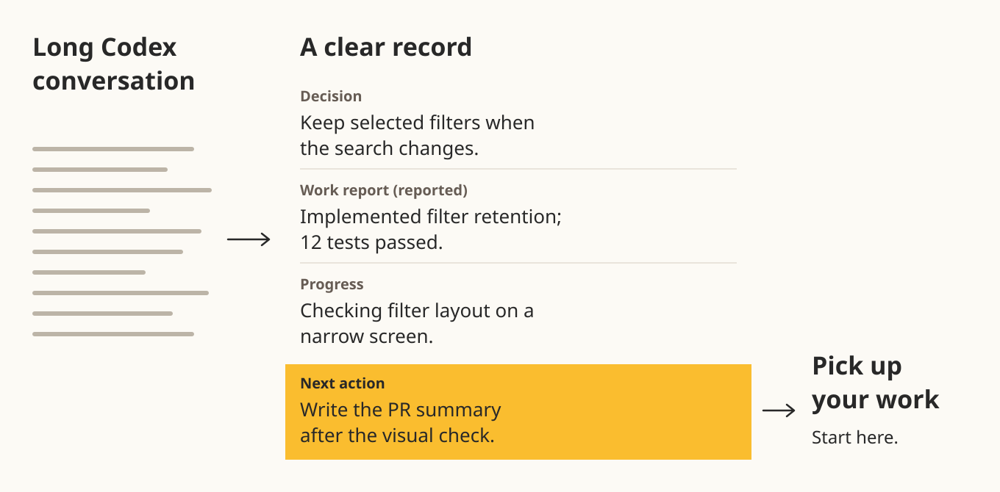

<p align="center">
  <picture>
    <source media="(prefers-color-scheme: dark)" srcset="docs/assets/brand/maeklog-02-horizontal-white.svg">
    
  </picture>
</p>

<p align="center">
  <strong>Pick up your Codex work where you left off.</strong><br>
  Decisions, progress and next actions beside your terminal.
</p>

<p align="center">
  <a href="#what-is-maeklog">What it is</a> ·
  <a href="#see-it-in-action">See it in action</a> ·
  <a href="#day-to-day-use">Everyday use</a> ·
  <a href="docs/setup.md">Setup guide</a> ·
  <a href="docs/setup.ko.md">한국어 설치 가이드</a>
</p>

## What is Maeklog?

Maeklog is a terminal side panel for **Codex in Herdr**. It turns a long conversation into a readable record of decisions, reported completions, current progress, blockers and next actions—with source quotations and timestamps you can check.

Each Herdr tab keeps its own records, organized by repository and branch. Start a new Codex session in the same tab and those records remain available for you to read.

## The problem it solves

You switch to another task. Hours later, you return to a long Codex conversation: which approach did you choose, what did Codex say was finished, and what still needs your attention?

Maeklog puts those answers beside the work, so you can regain context without rereading the whole conversation.

<picture>
  <source media="(max-width: 640px)" srcset="docs/assets/demo/overview-mobile.svg">
  
</picture>

## Who it is for

- **People juggling Codex tasks in several Herdr tabs**, including tasks in the same repository and branch.
- **People returning to long-running work** who need a clear place to find the decisions and next actions.
- **People who want to check what a summary is based on**, with evidence and corrections close at hand.

## See it in action


*Actual Maeklog terminal UI, in English, with fictional demo data. The work and test counts are example reports. [How this demo was captured](docs/assets/demo/README.md).*

In this example, the decision is to **preserve selected filters** when the search changes. Codex has **reported implementing the change and passing 12 tests**. A small-screen layout check is still in progress, and Codex's next action is to write the PR summary **after that check**.

The panel separates **current public progress** from **saved records**. A response ending is not treated as proof that the task is complete. Important decisions and completion reports can be opened to inspect their evidence and correct mistakes.

## Day-to-day use

After [setup](docs/setup.md), open Maeklog from a **regular Herdr shell** in your project tab:

```sh
herdr plugin action invoke open --plugin maeklog
```

**Click the Maeklog panel to focus it**, then use its keys. Open the menu with **`m`, `F10` or a right-click** to find all actions.

| Key | What it does |
| --- | --- |
| `m` / `F10` / right-click | Open the menu, including model and language settings. |
| `h` | Read all saved records without a model call. |
| `e` | Inspect source evidence, correct or exclude a record, or undo a correction. |
| `r` | Summarize today's pending completed turns or retry failures. |
| `b` | Choose an earlier or held date; `Enter` requests its summary. |
| `s` | Request a draft summary of the current public progress. |
| `l` / `o` | Correct issue and PR links / open a linked reference. |
| `v` | Refresh issue and PR information. |
| Arrow keys / `j` / `k` / mouse wheel | Scroll the panel. |
| `q` | Hide the panel while collection continues. |

Today's completed turns are summarized automatically. `r`, `b` and `s` can request additional model work. To stop collection and summaries, choose **Stop recording in this tab** in the menu. [Full controls and summary behavior](docs/setup.md#everyday-controls).

**Optional Herdr shortcuts:** after [configuring the keybindings](docs/setup.md#optional-open-and-hide-shortcuts), `prefix+m` opens the panel and `prefix+Shift+m` hides it. With Herdr's default prefix, press `Ctrl+B`, then `m` to open, or `Ctrl+B`, then `Shift+M` to hide. These shortcuts need that configuration first.

## Setup and configuration

Maeklog is currently available as a **manual source build**. Setup includes building the panel, trusting its four Codex hooks, and building a Maeklog-compatible **Codex 0.162.1** client. You will need Herdr 0.8.2 or later and the build tools listed in the guide. Linux x86_64 is validated; macOS is experimental and has not yet been verified on real hardware.

**[Follow the English setup guide →](docs/setup.md)** · **[한국어 설치 가이드 →](docs/setup.ko.md)**

Once installed, use the panel menu to choose the summary model and reasoning effort, set the language to **Auto, English or Korean**, and review or correct issue and PR links. Settings affect future summaries; changing them does not call a model or rewrite existing records. The default summary profile is `gpt-6-luna`, `medium` effort, Standard service. [Configuration and shortcuts](docs/setup.md#configuration).

## Privacy and model usage

Records are stored locally. Summarization sends **selected conversation text and a limited index of existing records** to a model service through Codex, and consumes additional model usage. **There is no monetary budget cap.** Showing public progress or reading saved records does not itself run a summary.

Storage is not encrypted. Pending conversation text, evidence and diagnostic files can contain sensitive information. Model summaries can also be wrong—check the evidence for important records. [What records can tell you](docs/setup.md#what-records-can-tell-you) · [Storage details](docs/setup.md#storage-and-privacy) · [Security policy](SECURITY.md).

## Documentation

- [English setup, controls and troubleshooting](docs/setup.md)
- [한국어 설치·설정·문제 해결 가이드](docs/setup.ko.md)
- [v0.14.0 public preview release notes](docs/releases/v0.14.0.md)
- [Getting started (Korean)](docs/getting-started.md) · [User guide (Korean)](docs/usage.md)
- [Codex integration and updates](integrations/codex/README.md)
- [Current UI contract](docs/ui-contract.md) · [Release validation status](docs/release-readiness.md)
- [MIT license](LICENSE) · [Historical architecture notes](docs/architecture.md)

Earlier design notes, dated verification records and older captures describe their own historical scope. Use the setup and user guides for current behavior.
