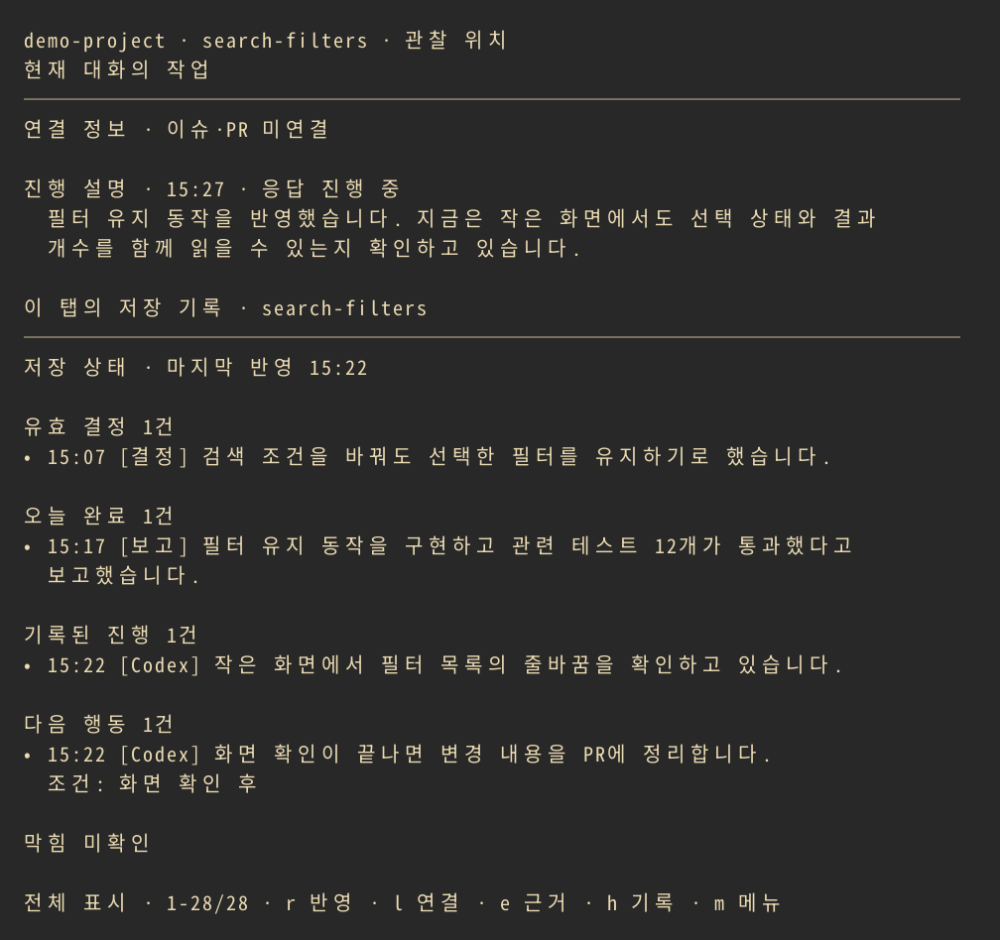

<p align="center">
  <picture>
    <source media="(prefers-color-scheme: dark)" srcset="docs/assets/brand/maeklog-02-horizontal-white.svg">
    
  </picture>
</p>

# Maeklog

**Keep the context of your Codex work organized, one Herdr tab at a time.**

See what was decided, what was reported complete, where work stands, what is blocked, and who should act next—with source evidence. Spend less time rereading long conversations when switching between tabs.

Codex does the work; Maeklog organizes the decisions and reports left in the conversation. Completion entries preserve the type of report, and next steps retain their owner and conditions. Execution, approval, and verification follow your usual workflow.



*The current terminal UI with fictional demo data, shown in Korean. The interface also supports English. [Capture provenance (Korean)](docs/assets/demo/README.md)*

## What you can see

- **Context per tab:** Keep records separate even when several tabs use the same repository and branch.
- **Decisions and completion reports:** Preserve active decisions, implementation, verification, merge and deployment reports, and their change history.
- **Current progress:** Read Codex's public commentary, plans and activity alongside recorded progress, blockers and next steps.
- **Evidence and corrections:** Check source quotations and timestamps, edit incorrect records, exclude them, or undo a correction.
- **Work references:** Review and correct the GitHub issue and PR links for the current conversation.
- **Summary settings:** Choose the summary model, reasoning effort, and Auto, English or Korean language in the menu.

## Before you start

Maeklog is available as source in [reganpark/maeklog](https://github.com/reganpark/maeklog). It has **not been registered or listed in Herdr Marketplace**. The instructions below describe manual setup from this repository.

Setup requires building Maeklog and a **Maeklog-compatible Codex 0.162.1 client**. The client patch supplies the tab identity and public progress that the panel needs.

| Requirement | Details |
| --- | --- |
| Operating system | Linux and macOS are declared targets. Native validation covers Linux x86_64; macOS has not been verified on real hardware. |
| Herdr | 0.8.2 or later. Run setup commands in a regular shell inside Herdr. |
| Codex | A signed-in official CLI with hooks enabled. The current integration patch targets 0.162.1. |
| Build tools | Python 3.11+, Git, GitHub CLI (`gh`), Rust/rustup, `just`, `cargo-nextest`, Node.js/npm, and Bazel or Bazelisk providing a `bazel` command. Maeklog pins Rust 1.97.1. |
| Terminal | UTF-8 display. Mouse and clipboard features depend on terminal support. |

**Usage and privacy:** Records are stored locally, but conversations selected for summarization and a limited index of existing records are sent to a model service through Codex. Summaries consume additional model usage, with no monetary budget cap. Hiding the panel keeps collection running; choose **Stop recording in this tab** in the menu to stop it.

## Manual setup from source

The [step-by-step guide (Korean)](docs/getting-started.md) includes prerequisites, configuration and troubleshooting. The same setup flow is outlined below.

1. In a regular Herdr shell, clone and build the source, then link the local checkout and install its collection hooks.

   ```sh
   git clone https://github.com/reganpark/maeklog.git
   cd maeklog
   cargo build --locked --release
   maeklog_root="$PWD"
   herdr plugin link "$maeklog_root"
   herdr plugin action invoke install-codex-hooks --plugin maeklog
   ```

   Local linking does not run build commands, so the build comes first. Keep this checkout available after setup: the updater uses its scripts and patches.

2. Open Codex and use `/hooks` to review and trust all four Maeklog handlers: **SessionStart, UserPromptSubmit, Stop and Interrupt**. If hooks are disabled, enable them and open a new Codex session:

   ```sh
   codex features enable hooks
   codex
   ```

   The installer does not grant hook trust on your behalf.

3. Exit the Codex input screen and return to the same **regular Herdr shell**. Check prerequisites, then build and activate the integrated client.

   ```sh
   python3 "$maeklog_root/scripts/update-codex-maeklog.py" --preflight
   python3 "$maeklog_root/scripts/update-codex-maeklog.py" 0.162.1 --apply
   ```

   `--preflight` checks local prerequisites and hook approvals without downloading, building or calling a model. `--apply` downloads and builds the source, runs validation, then connects the launchers. The build takes time and disk space.

4. In a new Herdr shell, check the launcher paths and versions.

   ```sh
   export PATH="$HOME/.local/bin:$PATH"
   command -v codex
   command -v codex-maeklog
   codex --version
   codex-maeklog --version
   ```

   The paths should be `~/.local/bin/codex` and `~/.local/bin/codex-maeklog`, with `codex-cli 0.162.1` reported by both. The official CLI reports the same version, so also check the launcher path and first conversation below. `codex-maeklog` is a package pointer for version diagnostics; use the installed `codex` launcher for interactive work.

   The PATH change applies to the current shell. Add the same line to your shell's startup file to retain it, such as `~/.bashrc` for Bash or `~/.zshrc` for Zsh. Existing Codex processes keep their original code; finish active work, exit normally, then resume with the new launcher.

5. In a regular Herdr shell in your project tab, open the panel.

   ```sh
   herdr plugin action invoke open --plugin maeklog
   ```

   Then start `codex` or `codex resume` from that shell and exchange a short, nonsensitive request. Public commentary appears when Codex provides it. After the response ends, check the saved-record update status; a turn may contain no confirmed decision or completion report. A response without commentary may show **No progress information**. Earlier conversations are not imported automatically. See [first-use checks (Korean)](docs/getting-started.md#5-첫-대화로-확인하기).

## Everyday controls

Click the panel to focus it before using its keys. Open the menu with `m`, `F10` or a right-click to find all actions.

| Input | Action |
| --- | --- |
| `h` | Read all saved records without a model call. |
| `e` | Inspect evidence, correct or exclude a record, or undo a correction. |
| `r` | Summarize pending completed turns from today, or retry failed work. |
| `b` | Select an earlier or held date; `Enter` requests its summary. |
| `s` | Request a draft summary of the current public progress. |
| `l` / `o` | Correct issue/PR links / open a linked reference. |
| `q` | Hide the panel while collection continues. |
| Arrow keys, `j`/`k`, mouse wheel | Scroll. |

After [configuring the shortcuts (Korean)](docs/getting-started.md#6-열기숨기기-단축키-설정), use `prefix+m` to open the panel and `prefix+Shift+m` to hide it. The default prefix is `Ctrl+B`: press `Ctrl+B`, then `m`. Use your own prefix if you changed Herdr's configuration.

Completed turns collected today are summarized automatically, newest batch first. Earlier dates, unknown timestamps and turns spanning midnight require selection with `b`. The same work receives at most three automatic attempts before its source is retained for an explicit retry. See [dates, retries and collection scope (Korean)](docs/usage.md#언제-자동으로-요약하나요).

## Model usage and stored data

The default summary profile is `gpt-6-luna`, reasoning effort `medium`, Standard service. Changing model or language settings does not run a summary or rewrite existing records. Summaries of completed turns and requests made with `r`, `b` or `s` can incur additional model usage.

The actual record directory is the `state_dir` value in `hook-runtime.json` inside Maeklog's configuration directory. Herdr's default plugin state path is `~/.local/state/herdr/plugins/maeklog`; configuration defaults to `~/.config/herdr/plugins/config/maeklog`. XDG paths and explicit settings can change these locations. Directory and file permissions are `0700` and `0600`; storage is not encrypted. Pending source text, evidence quotations and diagnostic files can contain sensitive conversations. See [storage and deletion (Korean)](docs/usage.md#모델-사용량과-저장) and the [security policy](SECURITY.md).

## Troubleshooting

| Symptom | Check first |
| --- | --- |
| The panel opens but new conversation data is missing | Check that the new terminal uses the integrated `codex` launcher, review all four handlers in `/hooks`, and rerun `--preflight`. |
| Today's records have not been reflected | Wait for the Codex response to finish, then press `r`. Use `b` for earlier or held turns. |
| Summary processing failed or automatic retries stopped | Open summary and processing details with `h`. Check model access, network and settings. After fixing the cause, use `r` for today or reselect the earlier date with `b`. |
| One conversation is open in two terminals and collection stops | New input is held when its submitting terminal is ambiguous. Continue from one terminal. |
| Dragging does not copy to the clipboard | Check OSC 52 support or use Herdr's `prefix+[` copy mode. |

Model interpretation can be wrong. Use `e` to check evidence and correct important records. The [full troubleshooting guide (Korean)](docs/getting-started.md#문제-해결) covers installation errors and updates.

## Documentation

[Getting started (Korean)](docs/getting-started.md) · [User guide (Korean)](docs/usage.md) · [Codex integration and updates](integrations/codex/README.md) · [Security](SECURITY.md) · [Current UI contract](docs/ui-contract.md) · [Release validation status](docs/release-readiness.md) · [MIT license](LICENSE) · [Historical architecture notes](docs/architecture.md)

Earlier design notes, dated verification records and older captures describe their own historical scope. Use the getting-started and user guides for current behavior.
